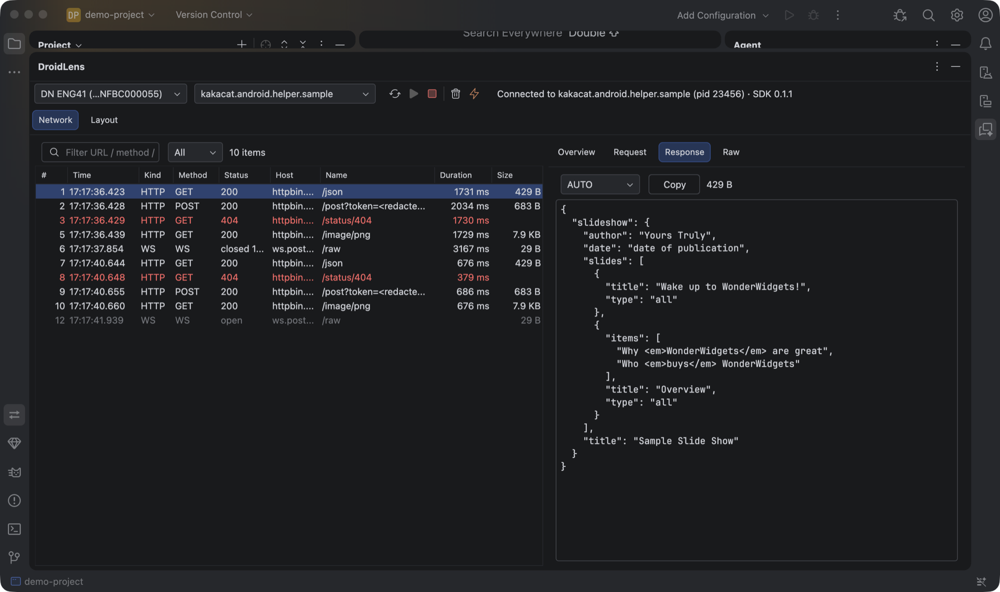
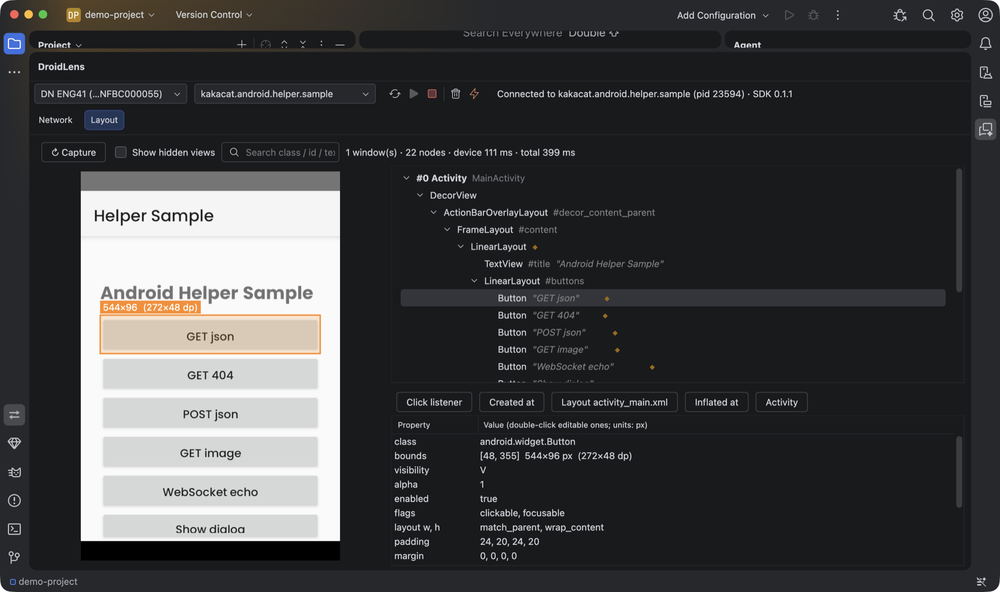

# DroidLens（Android Helper）

> Android Studio 插件在 JetBrains Marketplace 上的名字是 **DroidLens**；仓库、SDK 坐标和 MCP 服务沿用 android-helper 这个名字。




在 Android Studio 里直接调试运行中的 debug 包，不用开网页、不用配代理。

目前完成的能力：

| 标签页 | 能力 | 状态 |
|---|---|---|
| **Network** | 应用层抓包：OkHttp（HTTP/HTTPS 明文）、gRPC（含流式消息）、WebSocket（上下行帧） | ✅ |
| **Layout** | 截图 + View / Compose 树、属性查看与实时修改、一键跳到源码（移植 CodeLocator） | ✅ |
| **MCP** | 给 AI agent 用：以文本读写 View 树、点击/输入、查看抓包，不依赖截图 | ✅ |

## 目录

```
androidhelper/
├── sdk/                     App 侧（独立 Gradle build）
│   ├── runtime-core/        LocalSocket 服务、帧协议、事件总线、自动初始化
│   ├── runtime-network/     OkHttp / gRPC / WebSocket 采集 + 脱敏（源自 android-netcapture）
│   ├── runtime-layout/      窗口枚举、View 树 / Compose 语义树、PixelCopy 截图、属性修改
│   ├── gradle-plugin/       id("kakacat.android.helper")：按 build type 加依赖 + ASM 插桩
│   └── sample/              示例 App（造流量、XML + 代码混合布局、Dialog、Compose 页面）
├── client/                  和 IDE 无关的客户端：adb、帧协议、连接、抓包 / 布局数据模型
├── ide-plugin/              Android Studio 插件（Swing 原生 UI），依赖 client
├── mcp/                     MCP 服务（给 agent 用），依赖 client，独立于 Android Studio 运行
├── mvn-repo/                已发布的 SDK（raw.githubusercontent.com 直接读）
└── CodeLocator/             字节 CodeLocator 上游源码，仅供参考，不参与构建
```

## 在项目里接入

1. `settings.gradle(.kts)` 里加上仓库 —— **两处都要加**：Gradle 插件从 `pluginManagement`
   解析，运行时 AAR 从 `dependencyResolutionManagement` 解析。

   ```kotlin
   pluginManagement {
       repositories {
           maven { url = uri("https://raw.githubusercontent.com/kakakakacat/android-helper/main/mvn-repo/") }
           gradlePluginPortal()
           google()
       }
   }
   dependencyResolutionManagement {
       repositories {
           maven { url = uri("https://raw.githubusercontent.com/kakakakacat/android-helper/main/mvn-repo/") }
           google()
           mavenCentral()
       }
   }
   ```

   仓库是公开的静态目录，不需要 token。（发布到 GitHub 之前，可以先 `cd sdk && ./gradlew publishToMavenLocal
   :gradle-plugin:publishToMavenLocal`，再把上面的 url 换成 `mavenLocal()`。）

2. app 模块：

   ```kotlin
   plugins {
       id("kakacat.android.helper") version "0.1.1"
   }
   ```

   业务代码零改动。可选配置：

   ```kotlin
   androidHelper {
       buildTypes = setOf("debug", "internal")  // 按 build type；绝不要加 release
       scope = "all"                            // "all" 连三方依赖一起插桩；"project" 只处理本模块
       excludes = listOf("com/example/legacy/") // 额外排除的类名前缀
       network = true                           // 关掉则不加抓包运行时、不插桩
       layout = true                            // 关掉则不加布局运行时、不插桩
   }
   ```

4. 抓不到数据时先看插桩报告：`./gradlew :app:androidHelperReport`

**release 安全**：运行时 AAR 只加在白名单 build type 的依赖上，release 包里没有任何 SDK 代码
（已验证：sample 的 release dex 里搜不到 `kakacat/android/helper/network`）。

## 安装 IDE 插件

```bash
cd ide-plugin && ./gradlew buildPlugin
```

Android Studio → Settings → Plugins → ⚙ → Install Plugin from Disk →
选 `ide-plugin/build/distributions/android-helper-ide-0.1.0.zip`。

底部会出现 **DroidLens** 工具窗口：选设备 → 选 App → ▶ 连接。
连过一次之后，下次打开工具窗口时该 App 在运行就会自动连上；App 重启后自动重连。

- ⚡ 探针：让 App 发一个 HTTPS 请求，确认链路是通的
- 右键请求：复制 URL / 复制为 cURL / 复制响应 Body
- Body 视图：Auto / JSON / Text / Protobuf / Hex / Image
- gRPC：有 descriptor set 时按字段名解码（路径沿用 netcapture 的
  `assets/netcapture/descriptors.pb`），没有时按字段号启发式解码

### Layout 标签页

切到 Layout 标签自动抓取一次，之后点 ↻ 重新抓。**只在抓取时干活，不做持续刷新** ——
这是它在弱机器上比 Layout Inspector 轻的根本原因（sample 页面设备端耗时 70–90 ms，含截图）。

- **截图**：单击选中该点面积最小的 View，同一点连续单击逐层往外选；Shift + 单击第二个 View 显示间距（px / dp）
- **树**：View 树 + Compose 语义树（斜体），◆ 表示有源码位置；搜索框回车找下一个
- **跳转**：点击 / 长按 / 触摸监听、创建位置、布局 xml、inflate 位置、Dialog 弹出位置、Fragment、Activity、自定义 View 类
- **改属性**（双击值）：visibility、alpha、enabled、text、hint、textSize、textColor、background、
  padding、margin、layout 宽高、translation、scale、elevation；改完自动重抓
- **多窗口**：Activity、Dialog、PopupWindow 按叠放顺序拼在一起

源码位置靠构建期插桩（AGP Instrumentation API + ASM，替代 CodeLocator 用的 Lancet）：
`new XxxView()`、`setOnClickListener/LongClick/Touch`、`LayoutInflater.inflate`、`View.inflate`、
`setContentView(int)`、`Dialog.show()`、`AlertDialog.Builder.show()`。xml 里的子 View 没有单独的
位置，跳转按钮会用最近的祖先的布局文件。

限制：
- Compose 只能看到语义树（文本、testTag、Role、是否可点击、bounds），没有 Composable 函数名和源码位置
  （那需要 ui-tooling 的 slot table）；Compose 节点不能改属性。
- 截图首选 PixelCopy（API 26+），硬件位图、SurfaceView、TextureView 都能截到；拿不到 Window 时退回
  软件绘制。

### 兼容 android-netcapture

设备端同时监听 `androidhelper.<pkg>` 和 `netcapture.<pkg>` 两个名字，协议和 netcapture 完全一致：

- 老的网页控制台可以直接连新 SDK；
- IDE 插件也能连只接了老 netcapture SDK 的 App（列表里显示为 `<pkg> (netcapture)`）。

## MCP（给 AI agent 用）

让 Claude Code、Cursor 等 agent 直接读写运行中 App 的界面和网络请求。View 树以紧凑文本返回，
每行一个 View，带 id、坐标、文字和**源码位置**：

```
== window 0 Activity MainActivity [0,0 640x960]
[3] LinearLayout (0,160 640x752) layout=activity_main inflated=MainActivity.kt:32
  [4] TextView#title "Android Helper Sample" (48,256 526x75)
  [5] LinearLayout#buttons (48,355 544x557)
    [6] Button "GET json" (48,355 544x96) clickable created=MainActivity.kt:71 click=MainActivity.kt:74
```

agent 拿着 `[6]` 就能改属性、点击，拿着 `MainActivity.kt:74` 就能直接打开代码 —— 不用看截图猜。
截图工具仍然有，留给"颜色 / 图片 / 重叠"这类必须看图的问题。

**安装**：从 [Releases](https://github.com/kakakakacat/android-helper/releases) 下载 `android-helper-mcp.jar`，
或者 `cd mcp && ./gradlew fatJar`（产物在 `mcp/build/libs/`）。需要 Java 17+，Android Studio 自带的就行
（macOS：`/Applications/Android Studio.app/Contents/jbr/Contents/Home/bin/java`）。

```bash
# Claude Code
claude mcp add android-helper -- java -jar /path/to/android-helper-mcp.jar
```

```json
// Cursor 等：mcp.json
{ "mcpServers": { "android-helper": { "command": "java", "args": ["-jar", "/path/to/android-helper-mcp.jar"] } } }
```

adb 自动查找（`ANDROID_HOME` / 默认 SDK 路径 / PATH），也可以加参数 `--adb /path/to/adb`。

| 工具 | 作用 |
|---|---|
| `list_devices` / `list_apps` | 设备、接入了 SDK 的运行中 App |
| `get_view_tree` | View / Compose 树（文本），可指定子树 `root_id`、深度、是否含隐藏 View |
| `find_views` | 按文字 / id / 类名 / contentDescription 找 View，带父路径 |
| `get_view` | 一个 View 的全部属性、源码位置、父子节点、可修改的属性 |
| `set_view_property` | 运行时改属性（text、visibility、padding、颜色、宽高……），改完自动重新抓取 |
| `tap` / `input_text` / `press_key` | 按 View id 点击、输入、按键（走 adb input） |
| `screenshot` | 截图（可缩小），只在需要看视觉效果时用 |
| `list_requests` / `get_request` / `clear_requests` | 抓包：请求列表、详情（头、body、gRPC / WebSocket 消息） |

不传 `app` / `device` 时自动选：只有一台设备、一个 App 就用它，否则沿用上次的，再不行就报错并列出候选。
抓包从 MCP 第一次连上 App 开始记录。IDE 插件和 MCP 可以同时连同一个 App，互不影响。

## 设计要点

- **设备侧零暴露面**：只开 abstract LocalSocket，不监听 TCP 端口。
- **没人连时零开销**：所有采集点第一行判断有没有客户端（一次 volatile 读）。
- **业务线程只入队**：JSON、脱敏、写 socket 都在一条低优先级后台线程上；队列有界，满了就丢并上报丢弃数。
- **脱敏在设备侧做**：Authorization / Cookie / token 类 query 参数和 JSON 字段，出进程前就替换成 `<redacted>`。
- **IDE 不卡**：帧先进队列，EDT 上每 100ms 批量刷新一次；列表最多保留 5000 条。
- **不绑 AS 版本**：插件只用平台公开 API 和外部 `adb` 进程，不依赖 Android 插件的内部 API（CodeLocator 新版 AS 崩溃的主因），`untilBuild` 不设上限。

## 开发

```bash
# SDK
cd sdk
./gradlew :sample:assembleDebug
adb install -r -t sample/build/outputs/apk/debug/sample-debug.apk
# 不点屏幕造一批流量（GET / 404 / POST / 图片 / WebSocket）
adb shell am start -n kakacat.android.helper.sample/.MainActivity --ez burst true
adb shell am start -n kakacat.android.helper.sample/.MainActivity --ez dialog true   # 弹 Dialog
adb shell am start -n kakacat.android.helper.sample/.ComposeActivity                 # Compose 页面

# 客户端库（协议 / 模型）
cd client
./gradlew test                                   # 单元测试
ANDROIDHELPER_E2E=1 ./gradlew test               # 加上真机端到端（需要设备上跑着 sample）

# MCP
cd mcp && ./gradlew test fatJar

# IDE 插件
cd ide-plugin
./gradlew test buildPlugin
./gradlew runIde -PdemoProject=$PWD/../sdk \
    -PautoConnect=kakacat.android.helper.sample \
    -PdemoTab=Layout -PdemoSelect="GET json" -PdemoJump=click
# 沙箱 AS：自动打开工具窗口、连接、切到 Layout、选中按钮、跳到它的点击监听
```

发布流程（SDK → GitHub mvn-repo，插件 → JetBrains Marketplace）见
[ide-plugin/marketplace/PUBLISHING.md](ide-plugin/marketplace/PUBLISHING.md)。

编译针对的是本机 `/Applications/Android Studio.app`（不下载 IDE），路径可用
`-PandroidStudioPath=...` 覆盖。已在 Android Studio Quail 4（2026.1.4，build 261）上验证。

## License

Apache-2.0，见 [LICENSE](LICENSE)。
